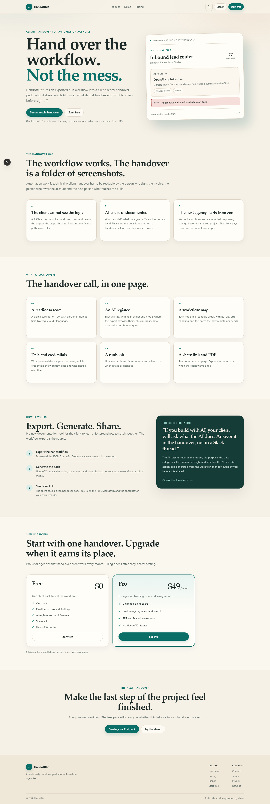
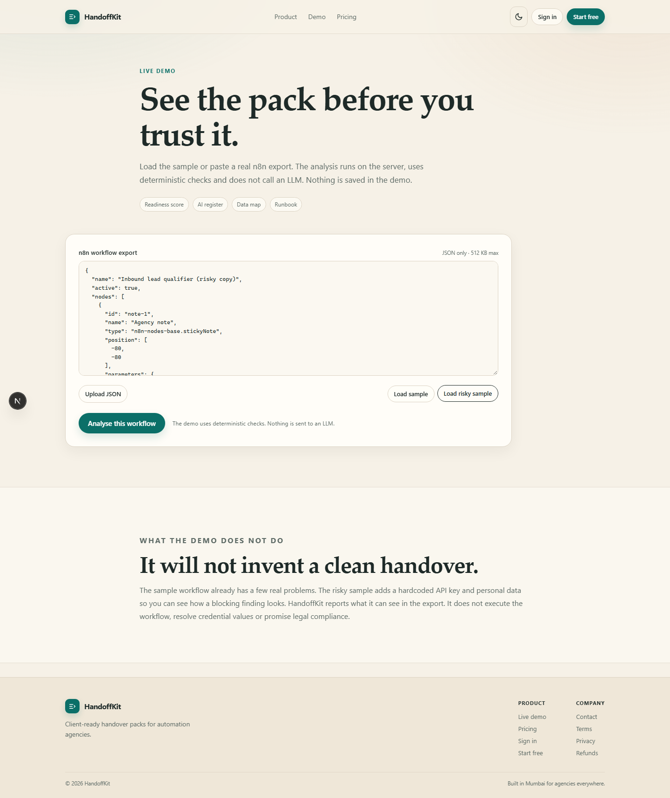
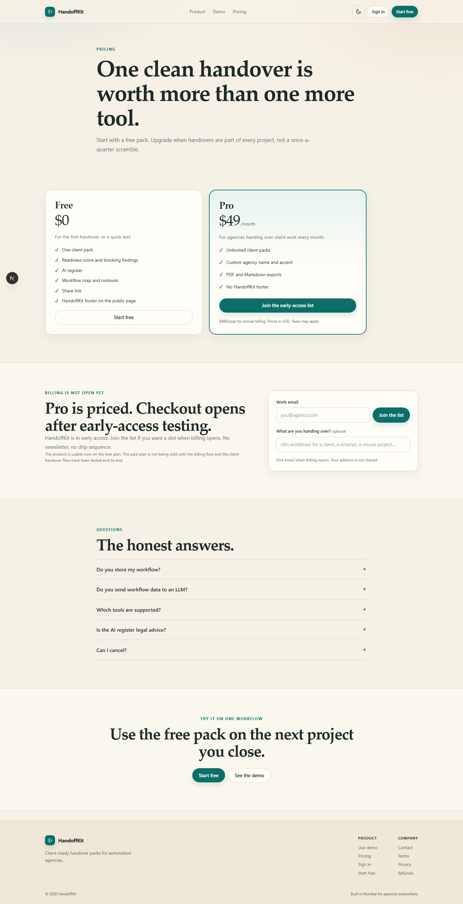

# HandoffKit

Client-ready handover packs for AI automation agencies.

HandoffKit turns an exported n8n workflow into a branded document that explains what the automation does, what data and AI it touches, and how to run it. It is built for agencies that hand workflows to clients and are tired of unpaid documentation work.

[](https://handoffkit-seven.vercel.app)
[](https://github.com/devtechedge/handoffkit/actions/workflows/ci.yml)
[](LICENSE)

## Live Demo

https://handoffkit-seven.vercel.app

> The demo runs on Vercel with the shared Neon Postgres database. Accounts, packs and
> subscriptions use the database. Billing is integrated but disabled until Lemon Squeezy
> environment variables are configured, so checkout stays off. The analysis is deterministic
> and never sends workflow data to an LLM. Nothing typed into the demo is stored.

## Screenshots







## What is in a pack

- Plain-language summary, trigger and execution steps.
- Systems and credentials inventory, with no secret values.
- AI register: provider, model, purpose, data categories, oversight and failure handling.
- Risk findings with severity and suggested fixes.
- Runbook: start, test, monitor, common failures and change process.
- Acceptance checklist and honest limitations.
- Branded share link, Markdown and PDF.

## Status

MVP, pre-revenue. The n8n importer, analysis, share page and PDF are real. Billing is
integrated but disabled until Lemon Squeezy environment variables are configured. There is no
AI-generated prose.

Read `docs/PROJECT_BRIEF.md` and `docs/DECISIONS.md` for the product reasoning.

## Stack

- Node 22 or newer.
- TypeScript, npm workspaces.
- `packages/core`: deterministic n8n parser, audit, Markdown, PDF, entitlements and Lemon Squeezy helpers.
- `apps/web`: Next.js 16, React 19, `@neondatabase/serverless`.
- Postgres on Neon, schema `handoffkit`.
- `pdf-lib` for server-side PDF.

## Local setup

```bash
npm install
cp .env.example .env.local
# set DATABASE_URL and SESSION_PEPPER
npm run db:setup
npm run dev:web
```

Open http://localhost:3000.

Without `DATABASE_URL`, the marketing site and demo still render. Signup and accounts need a database.

## Environment

| Name | Required | Purpose |
| --- | --- | --- |
| `DATABASE_URL` | yes for accounts | Neon Postgres connection string |
| `SESSION_PEPPER` | yes for accounts | Extra secret mixed into session tokens |
| `LEMONSQUEEZY_API_KEY` | no | Checkout API |
| `LEMONSQUEEZY_STORE_ID` | no | Checkout store relationship |
| `LEMONSQUEEZY_VARIANT_ID` | no | Pro plan variant |
| `LEMONSQUEEZY_WEBHOOK_SECRET` | no | Webhook signature verification |
| `NEXT_PUBLIC_SITE_URL` | no | Canonical URL, defaults to the request origin |

Never commit `.env.local`.

## Commands

```bash
npm test
npm run typecheck
npm run test:e2e
npm run build
npm run dev:web
npm run db:setup
```

## Deploy

The repo is configured for Vercel with `vercel.json`. The build command builds core first, then the web app.

```bash
vercel link
vercel env add DATABASE_URL production
vercel env add SESSION_PEPPER production
vercel --prod
```

## Security notes

- Passwords use scrypt with a random salt.
- Sessions are random 32-byte tokens, stored hashed, in HttpOnly cookies.
- Every pack query is scoped to the signed-in account.
- Share pages are unguessable and send `noindex, nofollow`.
- Credential names are shown; credential values are never read or stored.
- The parser masks secret-like values and does not put them in the pack, Markdown, PDF or events.
- The demo does not store the submitted workflow.
- The full threat model lives in `SECURITY.md`.

## Known limitations

- Only n8n JSON is supported. Make and Zapier are not.
- Analysis is static. It cannot see runtime data, credential values or n8n instance settings.
- Data categories and AI use are inferred from node types, names and parameters. They need human confirmation.
- No email verification, password reset or OAuth yet.
- Billing is not live.
- The AI register is a documentation aid, not legal advice.
- The shared Neon database uses a dedicated schema. Move to a dedicated project before paid launch.

## License

MIT.
